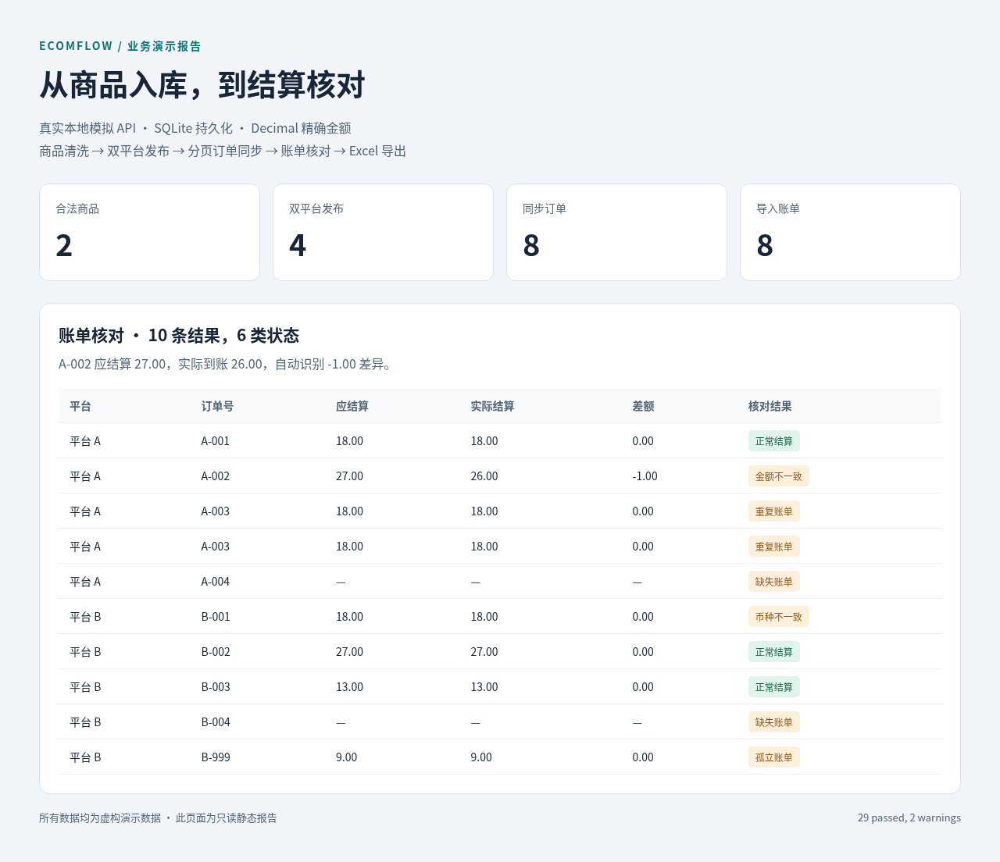
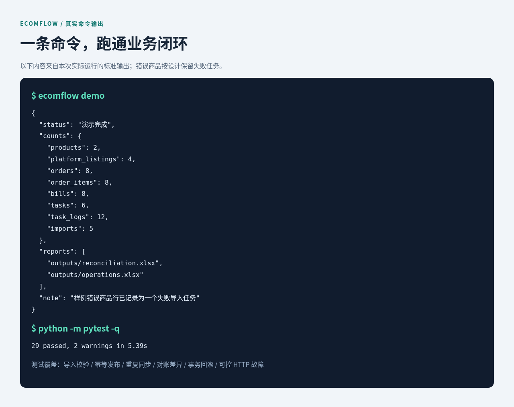

<div align="center">

# EcomFlow

### 多平台电商自动化：从商品入库，到结算核对

Python · Pandas · Requests · Pydantic · FastAPI · SQLite · Pytest

[快速开始](#快速开始) · [演示截图](#演示截图) · [完整使用指南](docs/usage.md) · [测试记录](docs/test_results.md)

</div>

模拟跨境电商公司的内部自动化流程：**商品清洗 → 双平台发布 → 订单同步 → 账单核对 → Excel 报告**。所有平台和业务数据均为本地虚构，适合演示 Python 自动化开发中的数据处理、接口可靠性和业务闭环。

## 核心亮点

| 能力 | 实际实现 |
| --- | --- |
| 数据可追溯 | CSV/Excel 导入，逐行校验，保留原始数据和错误原因 |
| 安全重试与幂等 | 双平台字段隔离、幂等发布、有限重试；重复同步不增加订单 |
| 精确对账 | Decimal 计算，识别金额差异、重复、缺失、孤立及币种不一致 |
| 失败可查可重跑 | SQLite 持久化任务状态、计数、错误和重试关联；真实 HTTP 故障测试 |

## 演示截图

**账单核对：业务结果一眼可见。** 从实际生成的 Excel 报告读取数据，展示 10 条核对结果。A-002 应结算 `27.00`、实际 `26.00`，差额 `-1.00`。



**完整运行：2 个商品、4 条发布记录、8 个订单、8 条账单。** 下图展示实际命令输出及本次测试结果，原始输出见 [运行记录](docs/assets/run-evidence.txt)。



> 截图中的页面是只读静态报告，项目操作入口为命令行，没有交互管理后台。样例故意包含 3 行错误商品，系统会保留一个失败导入任务，其余合法商品继续完成后续流程。

## 快速开始

需要 Python 3.11+，当前实测为 Python 3.12。无需独立数据库或 Docker。在仓库根目录执行：

```bash
python3 -m venv .venv
source .venv/bin/activate
python -m pip install -r requirements.lock
python -m pip install --no-deps --no-build-isolation -e .
ecomflow demo
```

`demo` 自动启动并检查本地模拟 API，完成业务流程后关闭它启动的服务。可以重复执行，订单和发布记录保持唯一，任务与导入审计按运行累积。

| 输出文件 | 内容 |
| --- | --- |
| `outputs/product_errors.xlsx` | 错误商品、原始行与原因 |
| `outputs/reconciliation.xlsx` | 对账差异、关联订单和源账单 |
| `outputs/operations.xlsx` | 商品、发布、订单和任务审计 |
| `logs/ecomflow.log` | 请求业务 ID、执行结果及异常 |

## 验证与技术资料

```bash
python -m pytest -q --junitxml=outputs/pytest-results.xml
```

**29 项测试通过**，包含真实本地 HTTP 故障注入和连续两次完整演示。当前存在两条第三方弃用告警，详见 [测试记录](docs/test_results.md)。

- [完整使用指南](docs/usage.md)：分步命令、输入示例、目录和已知限制。
- [系统架构](docs/architecture.md) · [数据库设计](docs/database_design.md) · [模拟 API](docs/api_design.md)
- [业务流程](docs/business_workflow.md) · [面试问答](docs/interview_questions.md)
- [截图复现与参考](docs/presentation.md)

第一版面向单机演示，不包含真实平台接入、生产鉴权、分布式调度或自动恢复崩溃任务。模拟 API 只应绑定本地回环地址。
