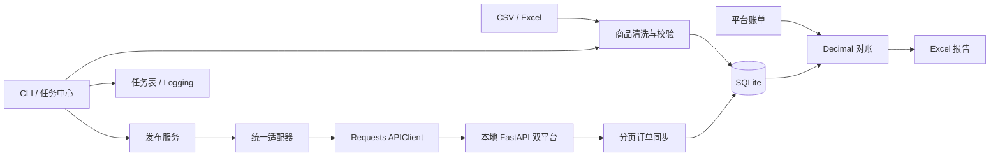

# EcomFlow

**Multi-Channel E-commerce Automation Framework**

模拟跨境电商公司的内部自动化系统，将商品清洗、双平台发布、订单同步、账单核对和任务审计连成可运行的业务闭环。项目面向 Python 电商自动化岗位演示；所有商品、订单、账单及平台均为虚构数据，不接入真实账户。

## 功能与技术选型

- Pandas 读取 CSV/Excel，Pydantic 校验商品，逐行保存原始输入及错误原因。
- 两个适配器隔离平台字段；Requests Session 提供超时、状态检查和有限安全重试。
- 分页订单同步、订单明细、唯一约束、持久化增量游标及整批事务回滚。
- Decimal 精确计算，SQLite 以 TEXT 保存金额；对账结果关联订单 ID 与账单 ID。
- 检出正常、金额差异、订单总额差异、缺失账单、孤立账单、重复账单及币种不一致。
- 任务中心持久化 PENDING/RUNNING/SUCCESS/FAILED、统计、错误、重试次数与任务日志。
- FastAPI 本地模拟平台，可控注入 401、429、500、超时、非法 JSON 和重复请求。
- OpenPyXL 导出 Excel；Pytest 包含数据库、业务、可靠性和真实 HTTP 集成测试。

使用 Python 3.11+；当前验证环境为 Python 3.12。SQLite 无需额外服务，不使用 Redis、Celery、Docker 或前端框架。

## 架构



## 目录

```text
src/ecomflow/
  core/          标准模型和时间工具
  ingestion/     CSV/Excel 读取、清洗、溯源
  adapters/      PlatformAAdapter / PlatformBAdapter
  clients/       APIClient 与明确的异常类型
  database/      SQLite schema、查询与事务边界
  services/      商品发布、订单同步、账单对账
  jobs/          持久化任务管理及日志配置
  reports/       运营数据导出
  cli.py         命令行与完整 demo
mock_platform/   本地模拟平台与故障控制
tests/          单元测试和真实 HTTP 集成测试
data/           虚构 CSV/Excel 样例
outputs/        本地数据库、运行结果和报告（忽略提交）
logs/           本地日志（忽略提交）
docs/           架构、数据库、API、流程、测试记录、面试材料
```

## 安装

在仓库根目录运行，Linux/macOS 示例：

```bash
python3 -m venv .venv
source .venv/bin/activate
python -m pip install -r requirements.lock
python -m pip install --no-deps --no-build-isolation -e .
ecomflow init-db
ecomflow init-demo
```

`requirements.lock` 记录本次 Python 3.12 实测版本。也可使用 `python -m pip install -e '.[test]'` 安装声明版本范围。Windows 使用 `.venv\Scripts\activate` 激活。`.env.example` 为变量说明，程序读取进程环境变量，不会自动加载 `.env`。

## 一条命令完整演示

```bash
ecomflow demo
ecomflow report
```

`demo` 自动启动临时本地模拟 API，完成健康检查、商品导入、双平台发布、远端商品查询、双平台分页同步、账单对账和报表导出；结束时关闭它启动的服务。再次执行会更新已有商品和订单，不会产生重复订单或重复发布记录。新启动的内存模拟平台会恢复已有成功的演示商品；历史任务和导入审计按运行次数增加，这是预期行为。

样例中故意包含 3 行错误商品，因此 demo 会持久化一个 **FAILED** 导入任务，并继续演示 2 行合法商品；这属于错误处理演示。单独执行 `import-products` 遇到错误行会返回退出码 1。对账业务差异写入报告，报告成功生成时任务状态为 SUCCESS，不表示所有账单一致。

两次实测 demo 后的稳定业务计数：

```json
{"products": 2, "platform_listings": 4, "orders": 8, "order_items": 8, "bills": 8}
```

输出：`outputs/product_errors.xlsx`、`outputs/reconciliation.xlsx`、`outputs/operations.xlsx`、`logs/ecomflow.log`。对账报告有 10 行：2 条正常、1 条金额差异、2 条重复账单、2 条缺失账单、1 条币种差异、1 条含退款的正常结算及 1 条孤立账单。正常合计 3 条。

## 分步运行

先在独立终端启动本地 API：

```bash
source .venv/bin/activate
python -m uvicorn mock_platform.app:app --host 127.0.0.1 --port 8000
```

在另一个终端、仓库根目录执行：

```bash
source .venv/bin/activate
ecomflow init-db
ecomflow init-demo
ecomflow import-products --file data/sample_products.csv
# 样例包含错误行：上条命令预期退出 1；合法商品仍已保存，可继续。
ecomflow publish-products --platform platform_a
ecomflow publish-products --platform platform_b
ecomflow sync-orders --platform platform_a
ecomflow sync-orders --platform platform_b
ecomflow sync-orders --platform platform_a
ecomflow reconcile --file data/sample_bills.csv
ecomflow listings --platform platform_a --sku SKU-001
ecomflow tasks
ecomflow report
```

全局参数位于子命令前：`ecomflow --db outputs/custom.sqlite3 --api-url http://127.0.0.1:8000 sync-orders --platform platform_a --full`。`--full` 重读所有订单并按唯一键更新。默认增量读取成功游标以后的订单。可使用 `--retry-of <失败任务ID>` 重新执行相同类型的导入、发布、同步或对账；每条重试链最多 3 次。

## 输入与输出示例

商品：

```csv
sku,title,description,price,currency,stock,category
SKU-001,旅行收纳袋,虚构演示商品,20.00,USD,100,travel
```

账单：

```csv
platform,platform_order_id,currency,gross_amount,refund_amount,fee_amount,settlement_amount,settlement_date
platform_a,A-001,USD,20.00,0.00,2.00,18.00,2026-01-10
```

`expected_settlement = gross_amount - refund_amount - fee_amount`，`difference = actual_settlement - expected_settlement`。A-002 预期 27.00、实际 26.00，差额为 `-1.00`，标记 `AMOUNT_MISMATCH`。金额报告单元格保存十进制文本，避免 Excel 浮点转换影响精度；可通过 `order_id` / `bill_id` 到报告源数据工作表核查。

## 数据库设计

`products` 以 SKU 为主键；`platform_listings` 唯一键为平台 + SKU；`orders` 唯一键为平台 + 平台订单 ID；`order_items` 外键关联订单。`bills` 保留来源文件和行号；同一来源重复导入在事务内替换，来源中的重复订单账单保留供对账识别。`imports` 保存商品原始行、清洗结果 SKU 和错误。`tasks`、`task_logs` 保存任务及审计；`sync_state` 保存平台游标。连接启用外键，异常自动回滚。完整字段见 [数据库设计](database_design.md)。

## 测试

```bash
python -m pytest -q --junitxml=outputs/pytest-results.xml
```

真实执行结果见 [测试记录](test_results.md)。集成测试启动真实本地端口，请在允许本地网络通信的环境运行；不依赖外部电商服务。故障注入方式见 [API 文档](api_design.md)。

## 已知限制与扩展

- 本地单进程演示系统，控制接口无鉴权，只应绑定回环地址；不部署到公网。
- 模拟平台商品保存在内存，独立启动服务重启会丢失；持久化或真实平台需要额外实现。自动 demo 已处理自己的模拟商品恢复。
- 当前增量游标为平台更新时间，要求平台提供一致的 UTC 时间与完整分页；生产环境应采用稳定游标或重叠时间窗口处理迟到数据。
- 同一时刻只运行一个同步/发布执行器；数据库约束避免重复本地记录，但未实现多工作进程分布式互斥。
- 没有真正后台队列、定时调度或崩溃后自动恢复 RUNNING 任务；可检查任务审计后显式重跑幂等命令。
- 完整同步在网络读取期间持有 SQLite 写事务，适合小批量演示；大数据量可改为暂存分页后短事务合并。
- 金额最多两位小数、18 位有效数字；不支持多币种汇兑或分批结算。重复账单按平台订单整体识别，退款与手续费来自账单。
- 下一步可增加认证、持久化模拟平台、配置化字段映射、稳定增量游标、调度器和账单版本审计。

更多资料：[架构](architecture.md) · [业务流程](business_workflow.md) · [面试问答](interview_questions.md)。
